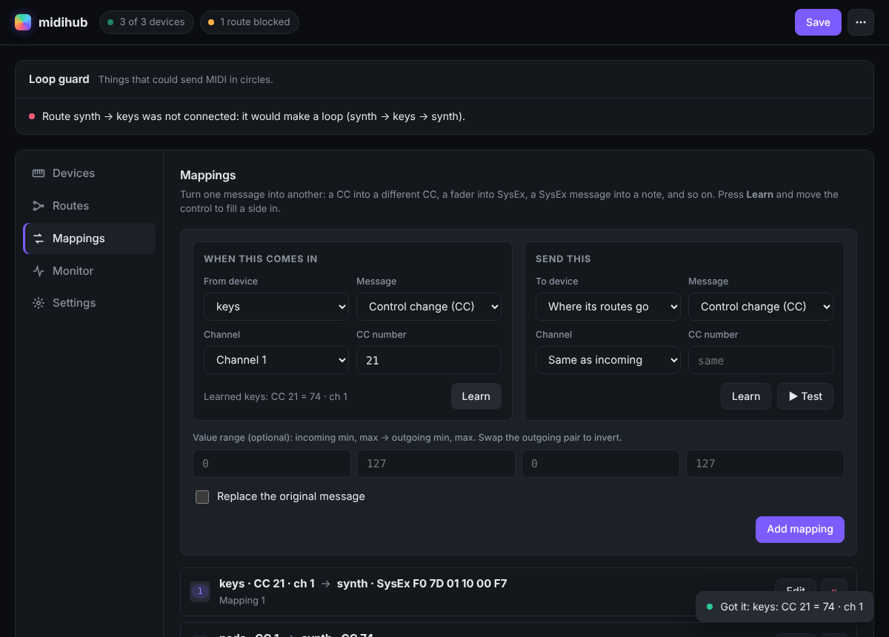

# midihub

> **This project is vibe coded.** It was built by describing what I wanted to
> AI coding assistants (opencode and Claude) and testing the result on my own
> instruments, not by writing every line by hand. It works well for me, but
> read the code before relying on it for anything critical, and expect rough
> edges. Issues and pull requests are welcome.

A headless USB-MIDI hub for Linux. Plug your instruments and controllers into a
PC or a small dedicated computer such as a Raspberry Pi, then use a web page to:

- **Route** any device to any other device. Routes are wired straight into the
  Linux MIDI system, so playing through midihub adds no noticeable delay.
- **Translate** messages: CC to CC, note to CC, CC to SysEx, SysEx to CC,
  SysEx to SysEx, pitch bend, aftertouch and program change, with optional
  value ranges and inversion.
- **Learn** instead of typing: press *Learn*, move a fader or hit a key, and
  the mapping fills itself in. SysEx messages are captured too, and the byte
  that carries the value is found automatically.
- **Stay safe from MIDI loops**: routes that would send MIDI in circles are not
  connected, and if messages start bouncing back between devices the source is
  muted for a moment and you get a warning on the page.
- **Share devices on the network** with `qmidinet` (optional).

Once configured, it needs no screen and no attention: it starts at boot, finds
your devices when you plug them in and loads your setup.



## Quick start on a Linux PC

```bash
# Debian / Ubuntu / Raspberry Pi OS
sudo apt install python3-rtmidi python3-flask alsa-utils
# Arch:   sudo pacman -S python-rtmidi python-flask alsa-utils
# Fedora: sudo dnf install python3-rtmidi python3-flask alsa-utils

git clone https://github.com/<you>/midihub.git
cd midihub
python3 web.py
```

Open <http://localhost:8080>. Your MIDI ports appear under **Devices**; click one
to add it, tick boxes under **Routes**, add translations under **Mappings**,
then press **Save**. Changes are live straight away.

Your user needs access to MIDI devices (on most systems: be in the `audio`
group).

## Dedicated box (Raspberry Pi or any Debian machine)

```bash
git clone https://github.com/<you>/midihub.git
cd midihub
sudo ./setup.sh            # add --no-qmidinet to skip network MIDI
```

`setup.sh` installs the dependencies, creates a `midihub` system user, copies
the app to `/opt/midihub`, asks for a web password and starts midihub on every
boot. Update later with `sudo ./update.sh`, remove with `sudo ./uninstall.sh`.

The full walkthrough, including a first mapping and network MIDI, is in
[TUTORIAL.md](TUTORIAL.md).

## Security in one paragraph

Anyone who can open the web page can change your routing. So, by default, the
page is only reachable from the machine midihub runs on. Set a password
(`python3 web.py --set-password`) and it opens to your network behind a login.
If you never want to change anything at a gig, set `"web": {"enabled": false}`
and midihub runs from its config file with no web server at all. The reasoning
and the other options are in [SECURITY.md](SECURITY.md).

## How it works

```
 USB devices ──► Linux ALSA sequencer ──► USB devices
                    │      ▲
   direct routes ───┘      │  (aconnect: no Python in the path)
                    ▼      │
                 midihub (Python)
                 • translations and "replace original" routes
                 • loop guard, learn, network export
                 • web UI (Flask)
```

- **Direct routes** are ALSA subscriptions made with `aconnect`. The kernel
  delivers those messages itself.
- **Translations** are handled by midihub: it reads every device input,
  matches your mappings and sends the result. A route only goes through
  midihub when a mapping with *Replace the original message* needs to hold
  messages back.
- Everything is stored in `config.json`, which reloads automatically when it
  changes, whether you save from the web page or edit the file by hand.

## Configuration file

`config.json` lives next to `web.py` (or set `MIDIHUB_CONFIG=/path/to/file`).
It is not part of the repository; start from
[config.example.json](config.example.json). Main sections:

| Section | What it holds |
|---|---|
| `devices` | `name: {"match": "text in the port name"}` |
| `routes` | `{"from": "keys", "to": ["synth"]}` |
| `mappings` | `{"input": {...}, "output": {...}}`, see below |
| `init` | messages sent to a device whenever it connects |
| `loop_guard` | `block_cycles`, `echo_guard`, `echo_trip`, `flood_limit`, `flood_mute`, `mute_seconds` |
| `network` | `export`: devices shared through qmidinet |
| `web` | `enabled`, `host`, `port`, `password_hash` (set with `--set-password`) |

A mapping side has a `type`: `cc`, `note`, `pc`, `pressure`, `polyat`,
`pitchbend` or `sysex`, plus optional `device`, `channel` (0 to 15) and number
(`cc`, `note` or `pc`). SysEx sides use `template` (the bytes) and
`value_index` (which byte carries the value). Outputs can add `scale`
(`[in_min, in_max, out_min, out_max]`) and `block_original`. Leaving an output
channel or number out reuses the incoming one; leaving the output device out
sends to wherever the input device is routed.

## Development

```bash
python3 -m unittest discover -s tests -t .   # no MIDI hardware or ALSA needed
python3 check.py                             # end-to-end through ALSA "Midi Through"
```

See [AGENTS.md](AGENTS.md) for design notes and python-rtmidi quirks.
